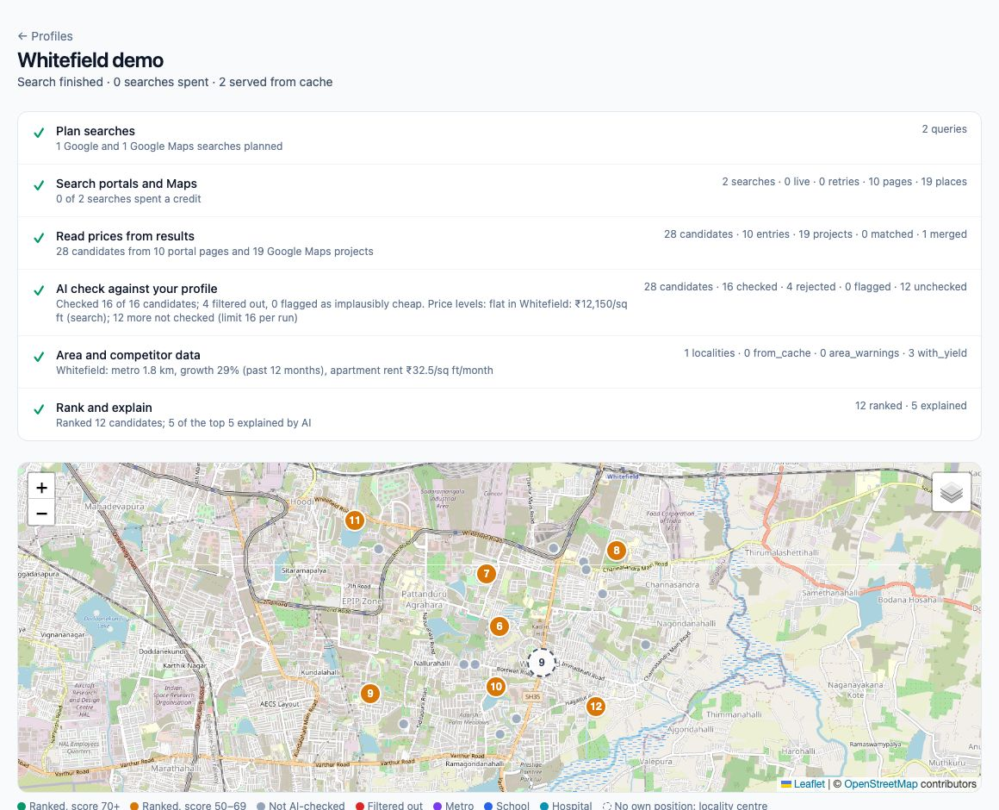
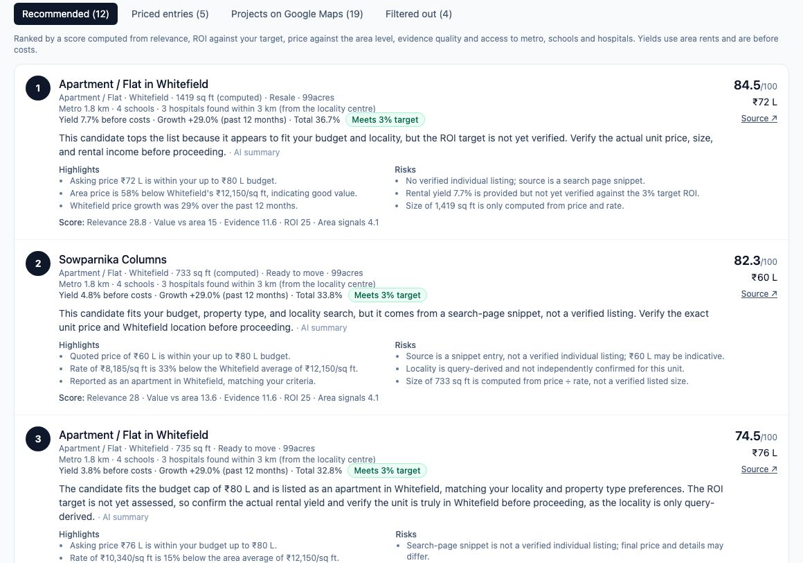
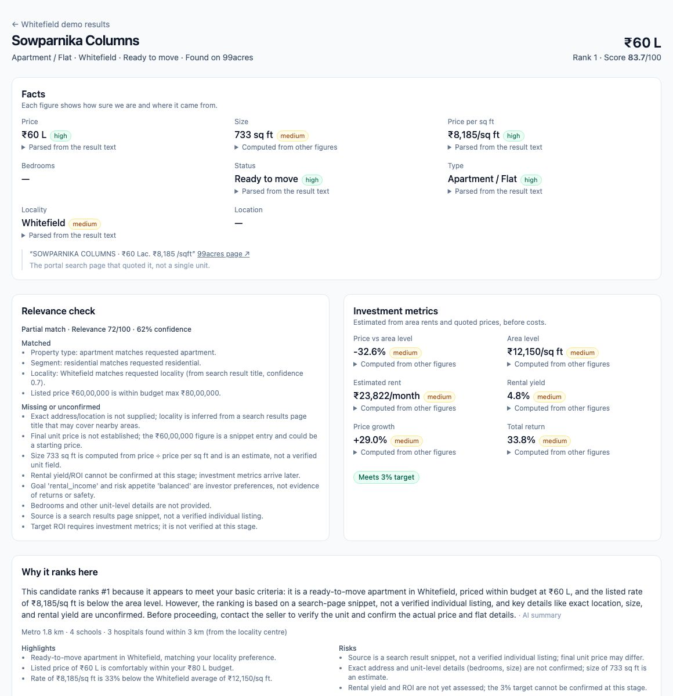
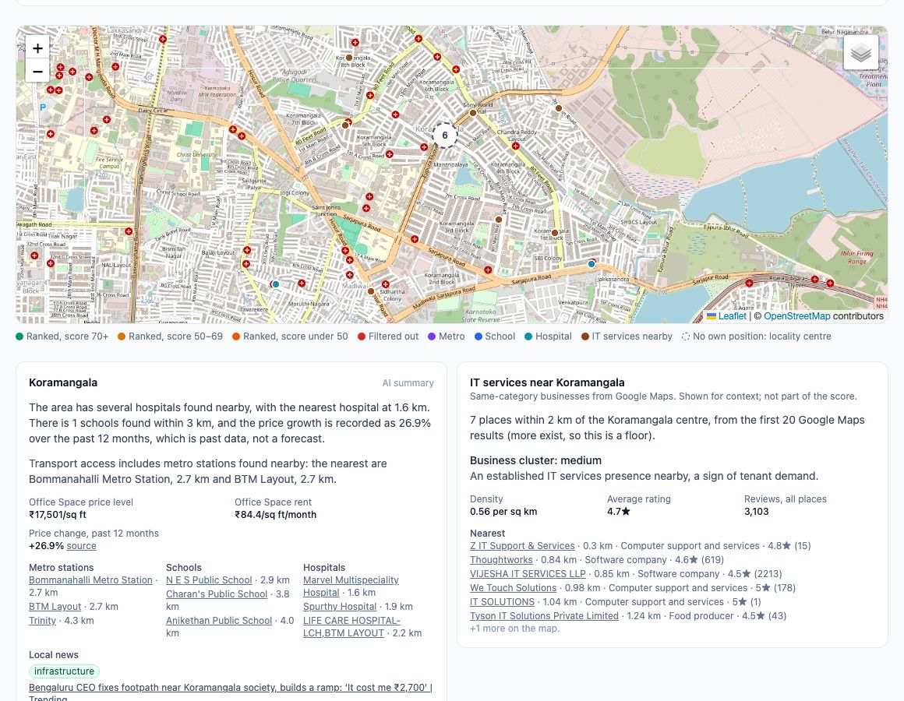

# Realty Intel

[](https://github.com/mrinesh/SerpAPI_Hack/actions/workflows/ci.yml)

**Real estate investor intelligence, built on live search data.** Tell it what you want to buy,
and it finds listings through SerpApi, has DeepSeek check each one against your criteria, adds
area intelligence (and nearby businesses for commercial property), and returns a ranked shortlist
with a reason, a confidence level and a source link for every number.

> Built for the SerpApi India Hackathon 2026 · Track: **Commerce & Market Intelligence** ·
> Demo market: **Bengaluru** · Runs offline from recorded data: `make setup && make demo`, no
> API keys needed. Status of every feature: **[CHECKLIST.md](CHECKLIST.md)**.



## Why

Investors research across many tabs: listing portals, maps, news, review sites and market data.
It is slow and inconsistent, and the results are hard to compare. Realty Intel runs one pipeline:

**criteria → search → clean → AI verification → area and competitor enrichment → ranked shortlist**

## What it does

| | |
|---|---|
| **Investor profile** | A three-step wizard: what (segment, property type, business for commercial), where (up to 5 Bengaluru localities), money (budget, goal, risk), with a suggested target ROI from sourced area data |
| **Discovery** | Site-filtered Google searches of 99acres, MagicBricks and NoBroker, reading the prices their search pages quote, plus housing projects from Google Maps |
| **AI verification** | DeepSeek V4 Pro fills missing fields only from quoted evidence, scores each candidate against the profile, and lists what matched, what did not and what is unconfirmed; hard limits such as budget are enforced in code |
| **Quality flags** | Prices implausibly far below the sourced locality price level are flagged (it caught a monthly rent quoted as a sale price) |
| **Area intelligence** | Per locality: geocoded centre, nearest metro stations, schools and hospitals (Maps), past-12-month price change and price level (Search), recent news labelled by topic (News), and a summary whose every number is checked |
| **Investment metrics** | Price vs area level, estimated rent, rental yield, price growth and total return against the investor's ROI target, all computed in code |
| **Ranking** | A score computed in code from relevance, value, evidence, ROI and area access, with an AI-written reason, highlights and risks for the top five (numbers checked against the figures) |
| **Competitor analysis** | Commercial: same-category businesses within 2 km of the locality, density, ratings and reviews, read as competition for shops and as a business cluster for offices |
| **Map** | Candidates at their Google Maps position, or grouped at the locality centre when none was quoted, with amenity and competitor layers |
| **Trust** | Every figure on the property page shows its confidence, how it was obtained and its sources, plus a "Where this came from" list |

| | |
|---|---|
|  |  |



## SerpApi usage

Everything the product knows comes from SerpApi, through the official `serpapi` Python SDK and
one gateway that adds a database cache, a search budget, and record/replay fixtures:

- **`google`**: site-filtered portal searches (discovery), locality price level per sq ft, past
  12-month price change, and rent levels.
- **`google_maps`**: housing projects with GPS (discovery), locality centres, nearby metro
  stations, schools and hospitals, and same-category businesses for commercial profiles.
- **`google_news`**: recent locality news, labelled by topic and sentiment.
- Free **Account API** for searches left (shown in the header) and the **Locations API** to fix
  the `location` parameter.

A fresh residential search of one locality costs about 10 searches; a repeat within the cache
window costs 0. Details, what we measured and the cost model:
**[docs/SERPAPI_USAGE.md](docs/SERPAPI_USAGE.md)**.

## Quickstart

Requires [uv](https://docs.astral.sh/uv/), Node.js 22 or 24 LTS (20.19+ works) and make.

```bash
git clone <repo-url> && cd SerpAPI_Hack
make setup    # installs backend + frontend, creates .env
make demo     # replay mode: no API keys needed, no searches spent
```

- App: <http://localhost:5173>
- API docs: <http://localhost:8000/docs>

`make demo` opens with two recorded profiles, **Whitefield demo** (an apartment under ₹80 L for
rental income) and **Koramangala office demo** (an office under ₹3 Cr for an IT services
business). Click **Find properties** on either to watch the pipeline run from recordings, then
open any candidate. Other profiles need live keys: replay mode can only answer searches that
were recorded.

To run against live data, put `SERPAPI_API_KEY` and `DEEPSEEK_API_KEY` in `.env`, set
`SERPAPI_MODE=live` and `LLM_MODE=live`, then `make dev`. See
[docs/DEVELOPMENT.md](docs/DEVELOPMENT.md#provider-modes).

## Architecture

```
React (Vite · TS · Tailwind · Leaflet)  ──/api──▶  FastAPI
                                                    ├─ services
                                                    ├─ pipeline: plan → fetch → clean → verify → enrich → rank
                                                    ├─ SerpApi gateway (cache · budget · record/replay) ──▶ SerpApi
                                                    ├─ LLM provider (record/replay) ──▶ DeepSeek
                                                    └─ SQLite
```

Full picture: [docs/ARCHITECTURE.md](docs/ARCHITECTURE.md) · stage detail:
[docs/PIPELINE.md](docs/PIPELINE.md) · decisions: [docs/decisions/](docs/decisions/).

## Repository layout

```
backend/      FastAPI app, pipeline, SerpApi/DeepSeek integrations, tests, recorded fixtures
frontend/     React app
docs/         product, architecture, pipeline, SerpApi usage, API, data model, ADRs
CHECKLIST.md  feature tracker: what's done, what's pending
CHANGELOG.md  dated log of changes
```

## Documentation

Start at **[docs/README.md](docs/README.md)**.

## AI disclosure

Developed with the help of Claude Code. DeepSeek is used inside the product for extraction,
verification and explanations.

## License

MIT, see [LICENSE](LICENSE).
