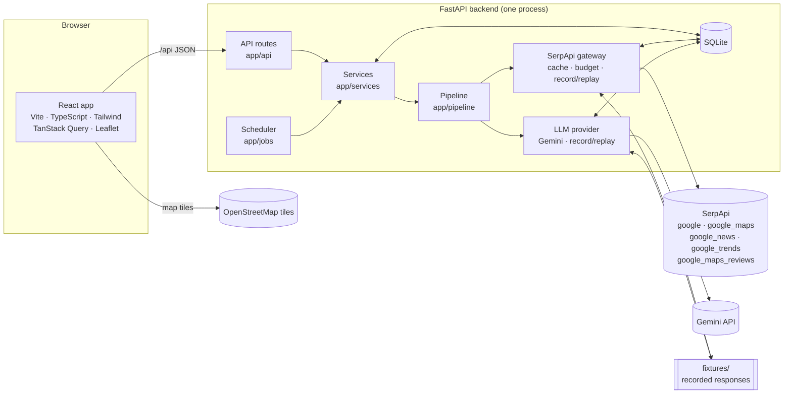
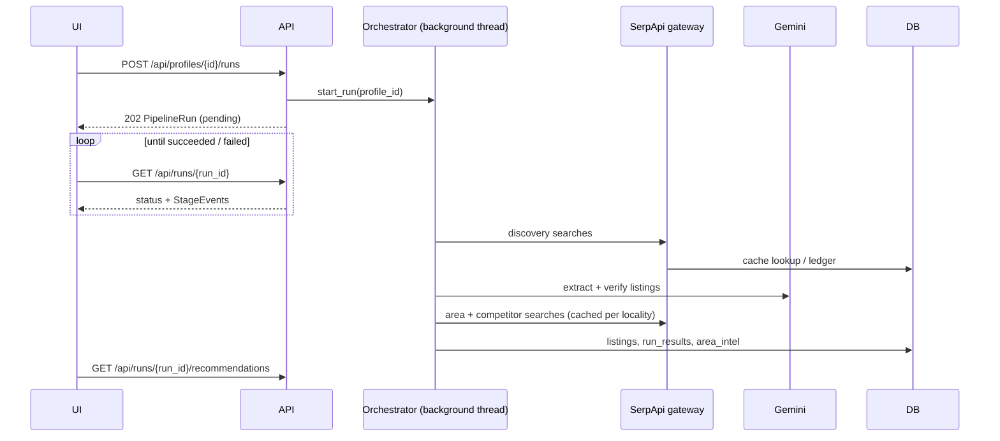

# Architecture

How the system is put together and why. For the stage-by-stage data flow see
[PIPELINE.md](PIPELINE.md); for the decisions behind each choice see [decisions/](decisions/).

## System overview



## Layers

| Layer | Location | Responsibility | Depends on |
|---|---|---|---|
| Frontend | `frontend/src` | Screens, map, comparison; no business logic | `/api` only |
| API | `backend/app/api` | HTTP shape, validation, status codes | services |
| Services | `backend/app/services` | Use cases: profiles, runs, detail, portfolio, alerts | pipeline, db |
| Pipeline | `backend/app/pipeline` | plan → fetch → clean → verify → enrich → rank | integrations, schemas |
| Integrations | `backend/app/integrations` | The only code that talks to SerpApi and Gemini | config, db |
| Schemas | `backend/app/schemas` | Pydantic domain models; the contract for every layer and for generated TS types | nothing |
| Data | `backend/app/db` | SQLAlchemy tables; nested objects stored as schema JSON | schemas |
| Jobs | `backend/app/jobs` | Scheduled alert checks (APScheduler, in-process) | services |

Dependencies point one way: api → services → pipeline → integrations. Routes never call the
pipeline or integrations directly, except `POST /profiles/{id}/runs`, which hands off to the
orchestrator.

## Key design rules

1. **One door to SerpApi.** Only `integrations/serpapi/gateway.py` imports `serpapi`. Caching,
   the search budget and record/replay live there, so no stage can spend searches by accident.
   ([ADR 0003](decisions/0003-record-replay-and-search-budget.md))
2. **Every fact is sourced.** Investor-facing values are `Sourced[T]`: value, confidence,
   extraction method, source links. ([ADR 0004](decisions/0004-provenance-on-every-field.md))
3. **Code decides numbers, the LLM handles language.** Scores, yields and price comparisons are
   computed in Python; Gemini extracts fields from messy text and writes explanations.
   ([ADR 0008](decisions/0008-code-computes-llm-explains.md))
4. **Enrich per locality, not per property.** Area intelligence is cached per locality and
   shared by every listing in it. ([ADR 0006](decisions/0006-locality-keyed-enrichment.md))
5. **Runs offline by default.** `SERPAPI_MODE` and `LLM_MODE` default to `replay`, so a fresh
   clone runs the demo with no keys and no spent credits.
6. **Schemas are the contract.** Frontend types are generated from the backend's OpenAPI
   schema (`make types`), so the two sides cannot drift silently.

## Request lifecycle: a pipeline run



## Error contract

All errors are `{"error": {"code", "message", "details"}}` (`app/core/errors.py`).

| Code | HTTP | Meaning |
|---|---|---|
| `not_found` | 404 | Unknown id |
| `validation_error` | 422 | Invalid input; `details.fields` lists `{loc, msg}` per field |
| `not_implemented` | 501 | Scaffolded, not built; `details.feature_id` names the CHECKLIST row |
| `search_budget_exceeded` | 429 | A live search would exceed the run or monthly budget |
| `replay_miss` | 503 | Replay mode has no fixture for this request |
| `provider_not_configured` | 503 | A live call needs an API key that is not set |
| `upstream_error` | 502 | SerpApi or Gemini failed or returned an unusable response |
| `internal_error` | 500 | Anything else |

## Configuration

All settings are in `backend/app/config.py` and read from `.env` at the repo root
(template: [`.env.example`](../.env.example)). See [DEVELOPMENT.md](DEVELOPMENT.md#configuration).

## Directory map

```
backend/
  app/
    api/            routes, dependencies, router
    core/           errors, logging
    db/             engine/session, tables
    integrations/
      serpapi/      gateway (cache, budget, record/replay), engine param builders
      llm/          provider protocol, Gemini, record/replay wrapper, prompts/*.md
    jobs/           APScheduler wiring, alert job
    pipeline/       one module per stage; enrichment/ for area and competitors
    reference/      static market data (Bengaluru localities)
    cli.py          developer command line: one search or budget check through the gateway
    schemas/        Pydantic domain models
    services/       use cases behind each route
  fixtures/         recorded SerpApi and LLM responses (committed)
  scripts/          analysis scripts, e.g. s01_analyze.py for the data-coverage spike
  tests/            unit/ and integration/
frontend/
  src/
    api/            fetch client, generated OpenAPI types
    components/     shared UI
    pages/          one file per route
docs/               this documentation
```
