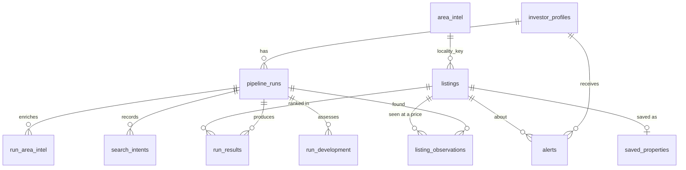

# Data Model

Two layers:
- **Domain schemas** (`backend/app/schemas`, Pydantic): the shape of every object. The single
  source of truth for the API and for the generated frontend types.
- **Tables** (`backend/app/db/models.py`, SQLAlchemy on SQLite): nested domain objects are stored
  as JSON produced by their schema. Columns exist only for what we filter, join or sort on.

## Provenance: `Sourced[T]`

Every investor-facing fact is wrapped like this (`schemas/provenance.py`):

```jsonc
{
  "value": 8500000,
  "confidence": 0.9,
  "method": "regex",            // serpapi_field | regex | llm | computed | query
  "sources": [{
    "engine": "google",
    "url": "https://www.99acres.com/...",
    "title": "2 BHK Flat for Sale in Whitefield",
    "search_id": "6710c3..."     // re-openable via the SerpApi Search Archive API
  }],
  "note": "price shown as a range; lower bound used"
}
```

## Domain schemas

| Schema | Module | Purpose |
|---|---|---|
| `InvestorProfileIn` / `InvestorProfile` | `profile.py` | Criteria for a run |
| `RawSearchHit` | `listing.py` | One portal page (Google) or housing place (Maps) before cleaning, with the locality and type it was searched for |
| `Listing` | `listing.py` | A discovered candidate: `snippet_entry` (priced entry quoted on a portal search page) or `project` (Google Maps place). Name, url, price, ₹/sq ft, size, BHK, sale status, GPS, rating, evidence text; all facts `Sourced` ([ADR 0011](decisions/0011-discovery-from-search-snippets.md)) |
| `Verification`, `QualityFlag` | `listing.py` | LLM match score, verdict, mismatches, flags |
| `AreaIntel` (+ `Amenity`, `NewsItem`, `PriceTrend`, `RentalDemand`) | `area.py` | Per-locality intelligence |
| `AreaDevelopment`, `SearchMomentum`, `InterestPoint`, `DevelopmentHypothesis` | `development.py` | Measured public/app histories, research priorities and cited unconfirmed causes |
| `CompetitorReport`, `Competitor` | `competitor.py` | Commercial competition around a point |
| `InvestmentMetrics` | `metrics.py` | Price per sq ft vs area, rental yield, price growth, total return, target check |
| `Recommendation` | `recommendation.py` | Rank, composite score, breakdown, reason |
| `PipelineRun`, `StageEvent` | `run.py` | Run status and live progress |
| `PropertyDetail`, `CompareResult`, `SavedProperty`, `Alert`, `BudgetStatus`, `HealthStatus` | `views.py` | Screen-specific responses |

## Investor profile

`InvestorProfileIn` (`schemas/profile.py`); every check is field-level so the UI can highlight it.

| Field | Rule |
|---|---|
| `name` | required, 1–80 chars |
| `segment` | `residential` or `commercial` |
| `property_types` | 1+ of the segment's types: Apartment / Flat, Independent House / Villa, Builder Floor, Plot / Land; Office Space, Shop / Showroom, Warehouse / Godown, Commercial Land |
| `size_min_sqft`, `size_max_sqft` | optional, max ≥ min |
| `business_type` | required for commercial, not allowed for residential; free text (UI suggests a few) |
| `city`, `localities` | 1–5 unique slugs from `app/reference/<city>.json` (checked in the service) |
| `must_haves` | optional, up to 10 non-empty strings |
| `budget_min_inr`, `budget_max_inr` | whole rupees; max required, max ≥ min |
| `goal`, `target_roi_pct` | the goal picks the ROI measure (`roi_measure`); target 0–100 ([ADR 0010](decisions/0010-roi-definition.md)) |
| `expected_growth_pct` | optional override of the locality's past-12-month change, −100 to 100 |
| `risk_appetite` | `conservative`, `balanced` or `aggressive` |

## Tables

| Table | Key | Holds | Notes |
|---|---|---|---|
| `investor_profiles` | `id` | `InvestorProfileIn` JSON | |
| `pipeline_runs` | `id` | status, current stage, `StageEvent[]`, searches used, cache hits | FK profile |
| `listings` | `id` = stable hash of the candidate's identity | `Listing` JSON; `kind`, `portal`, `locality`, `price_inr`, `size_sqft`, `price_per_sqft` columns | Shared across runs, so a repeat run updates the same rows |
| `listing_observations` | `id`; unique (`listing_id`, `run_id`) | price at the time | One row per candidate per run: "found in this run" and price history |
| `run_results` | `id` | Progressive JSON: `listing`, nullable `verification`, F-09 `metrics` including frozen target/source notes; F-04 will add recommendation fields | One row per listing per run; rank null until ranked, and for rejects |
| `area_intel` | `locality_key` | Normalized `AreaIntel` JSON, assembly/expiry timestamps | Shared locality cache; excludes run-specific prices; partial results expire immediately |
| `run_area_intel` | (`run_id`, `locality_key`) | Frozen `AreaIntel` JSON, including existing price benchmarks | FK run; deleted with profile; unaffected by later cache refreshes |
| `search_intents` | (`run_id`, `locality_key`) | Requested locality, profile ID, UTC creation time | Actual run-start intent; count distinct profiles/week; FK run cascades on deletion |
| `run_development` | (`run_id`, `locality_key`) | Frozen `AreaDevelopment` JSON | FK run cascades; old reports retain their historical aggregates |
| `competitor_reports` | hash(centre, category, radius) | `CompetitorReport` JSON | |
| `serp_cache` | `cache_key` | raw SerpApi JSON, `search_id` | Same key as fixture file names |
| `search_ledger` | autoincrement | engine, key, run, `live` | Budget is computed from this |
| `llm_cache` | hash(task, model, tier, prompt, schema) | validated LLM output | Replay reads fixtures only; record writes cache hits too |
| `saved_properties` | `listing_id` | note, saved time | |
| `alerts` | `id` | kind, listing, message, read time | |



## F-05 area payload

`AreaIntel` adds centre provenance, structured `InfrastructureFact` evidence, `AreaIssue` warnings,
section statuses, source retrieval timestamps, cache flags and a per-property-type benchmark map.
Assembly time differs from original provider retrieval/publication time. Price growth and rental
demand remain unavailable in the generic area payload; F-09 keeps type-specific annual growth
and candidate rents in the financial snapshot. See [F-05 guide](F05_AREA_INTELLIGENCE.md) and
[F-09 guide](F09_INVESTMENT_METRICS.md). The added run-area table is
created automatically at startup; no existing tables or data need to be dropped.

Public/app demand history and observed price corroboration now live in `run_development`,
separate from the shared generic area cache. Its two new tables are created on startup without
resetting data. No browser history or profile identifiers are sent to the development-review
prompt; app history is aggregate distinct-profile weekly counts. See
[search-driven research](SEARCH_DRIVEN_AREA_INSIGHTS.md).

## F-09 financial snapshots

F-09 appends sourced `InvestmentMetrics` to `run_results` without adding tables or columns.
Snapshots preserve `target_roi_pct`, `roi_measure`, nullable `meets_target_roi` and the reason
an assessment is unavailable. Each candidate is committed independently. Source unions and
the weakest input confidence are preserved; changing a profile or shared listing leaves earlier
comparisons unchanged. No database reset is needed for F-09.

## Changing the model

1. Edit the Pydantic schema in `app/schemas`.
2. If a filtered or sorted column is needed, add it to `app/db/models.py`. There are no
   migrations during the hackathon: drop the changed table (e.g. `sqlite3 backend/data/realty_intel.db
   "drop table listings"`) and restart, or `make reset-db` to recreate everything. Dropping one
   table keeps the search ledger, which the monthly budget is counted from.
3. Run `make types` to regenerate the frontend types.
4. Update this page.
