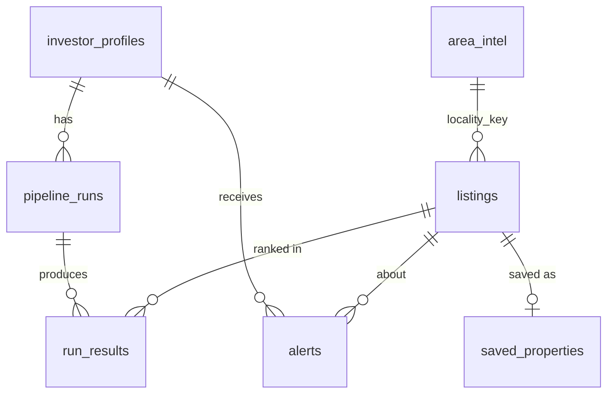

# Data Model

Two layers:
- **Domain schemas** (`backend/app/schemas`, Pydantic): the shape of every object. The single
  source of truth for the API and for the generated frontend types.
- **Tables** (`backend/app/db/models.py`, SQLAlchemy on SQLite): nested domain objects are stored
  as JSON produced by their schema. Columns exist only for what we filter, join or sort on.

## Provenance: `Sourced[T]`

Every investor-facing fact is wrapped like this (`schemas/provenance.py`):

```jsonc
{
  "value": 8500000,
  "confidence": 0.9,
  "method": "regex",            // serpapi_field | regex | llm | computed
  "sources": [{
    "engine": "google",
    "url": "https://www.99acres.com/...",
    "title": "2 BHK Flat for Sale in Whitefield",
    "search_id": "6710c3..."     // re-openable via the SerpApi Search Archive API
  }],
  "note": "price shown as a range; lower bound used"
}
```

## Domain schemas

| Schema | Module | Purpose |
|---|---|---|
| `InvestorProfileIn` / `InvestorProfile` | `profile.py` | Criteria for a run |
| `RawSearchHit` | `listing.py` | One SerpApi result before cleaning |
| `Listing` | `listing.py` | Cleaned, de-duplicated property candidate; all facts `Sourced` |
| `Verification`, `QualityFlag` | `listing.py` | LLM match score, verdict, mismatches, flags |
| `AreaIntel` (+ `Amenity`, `NewsItem`, `PriceTrend`, `RentalDemand`) | `area.py` | Per-locality intelligence |
| `CompetitorReport`, `Competitor` | `competitor.py` | Commercial competition around a point |
| `InvestmentMetrics` | `metrics.py` | Price per sq ft vs area, rental yield, price growth, total return, target check |
| `Recommendation` | `recommendation.py` | Rank, composite score, breakdown, reason |
| `PipelineRun`, `StageEvent` | `run.py` | Run status and live progress |
| `PropertyDetail`, `CompareResult`, `SavedProperty`, `Alert`, `BudgetStatus`, `HealthStatus` | `views.py` | Screen-specific responses |

## Investor profile

`InvestorProfileIn` (`schemas/profile.py`); every check is field-level so the UI can highlight it.

| Field | Rule |
|---|---|
| `name` | required, 1–80 chars |
| `segment` | `residential` or `commercial` |
| `property_types` | 1+ of the segment's types: Apartment / Flat, Independent House / Villa, Builder Floor, Plot / Land; Office Space, Shop / Showroom, Warehouse / Godown, Commercial Land |
| `size_min_sqft`, `size_max_sqft` | optional, max ≥ min |
| `business_type` | required for commercial, not allowed for residential; free text (UI suggests a few) |
| `city`, `localities` | 1–5 unique slugs from `app/reference/<city>.json` (checked in the service) |
| `must_haves` | optional, up to 10 non-empty strings |
| `budget_min_inr`, `budget_max_inr` | whole rupees; max required, max ≥ min |
| `goal`, `target_roi_pct` | the goal picks the ROI measure (`roi_measure`); target 0–100 ([ADR 0010](decisions/0010-roi-definition.md)) |
| `expected_growth_pct` | optional override of the locality's past-12-month change, −100 to 100 |
| `risk_appetite` | `conservative`, `balanced` or `aggressive` |

## Tables

| Table | Key | Holds | Notes |
|---|---|---|---|
| `investor_profiles` | `id` | `InvestorProfileIn` JSON | |
| `pipeline_runs` | `id` | status, current stage, `StageEvent[]`, searches used, cache hits | FK profile |
| `listings` | `id`, unique `canonical_url` | `Listing` JSON, `locality_key`, `last_price_inr` | Shared across runs; enables price-drop alerts |
| `run_results` | `id` | `Recommendation` JSON, `rank` | One row per listing per run; rank null when rejected |
| `area_intel` | `locality_key` | `AreaIntel` JSON, `expires_at` | e.g. `bengaluru/whitefield` |
| `competitor_reports` | hash(centre, category, radius) | `CompetitorReport` JSON | |
| `serp_cache` | `cache_key` | raw SerpApi JSON, `search_id` | Same key as fixture file names |
| `search_ledger` | autoincrement | engine, key, run, `live` | Budget is computed from this |
| `llm_cache` | hash(task, model, prompt) | validated LLM output | |
| `saved_properties` | `listing_id` | note, saved time | |
| `alerts` | `id` | kind, listing, message, read time | |



## Changing the model

1. Edit the Pydantic schema in `app/schemas`.
2. If a filtered or sorted column is needed, add it to `app/db/models.py`. There are no
   migrations during the hackathon: delete `backend/data/realty_intel.db` to recreate tables.
3. Run `make types` to regenerate the frontend types.
4. Update this page.
