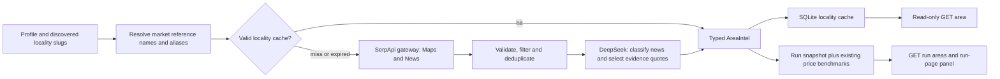

# F-05 Area intelligence: implementation and debugging

F-05 enriches each discovered locality, after verification. It does not rank properties,
calculate investment returns or analyze commercial competitors. Graphify is the repository's
navigation tool; Realty Intel is the application implemented here.

## Architecture



One new locality costs at most five searches: centre, metro, school, hospital and news.
News classification and quote selection cost up to two DeepSeek calls. No article bodies are
fetched. All requests use the existing budgeted/cached recording gateways.

## Important code: input, transformation, output and failure signals

| File | Input / transformation / output | Failure and debug signal |
|---|---|---|
| `backend/app/pipeline/enrichment/area_sources.py` | Reference locality slug/name/alias and raw Maps/News results → validated, filtered `Amenity`, `NewsItem` and coordinates | Unknown locality → 422; malformed provider fields → `upstream_error`; ambiguous geocode → missing centre |
| `backend/app/pipeline/enrichment/area.py` | Pipeline context and existing price levels → cache lookup, provider aggregation, LLM evidence validation → `AreaIntel` | Logs identify locality, operation, provider and error code; failed sections appear in `warnings` |
| `backend/app/schemas/area.py` | Adds typed `InfrastructureFact`, `AreaIssue`, section status, source retrieval timestamps, cache state and per-type existing benchmarks | Pydantic validation prevents invalid serialized domain data |
| `backend/app/integrations/llm/prompts/classify_news.md`, `summarize_area.md` | News titles/snippets → topic/sentiment labels and selected evidence quotes | Unknown indices, missing coverage and changed/shortened quotes are rejected by aggregation code |
| `backend/app/db/models.py` | Existing `area_intel` stores shared JSON; new `RunAreaIntelRow` stores one frozen payload per run/locality | SQLite errors propagate; no migrations/reset needed for the new table—startup creates it |
| `backend/app/pipeline/orchestrator.py` | Unique discovered locality slugs → enrichment, progress counts and incremental snapshot commits | Earlier snapshots/checks survive later failures; search counts now include enrichment |
| `backend/app/services/properties.py` | Canonical area key → validate persisted payload and mark expiry → read-only `AreaIntel` | 404 before enrichment; 422 for unknown geography; corrupt cache → `internal_error` with `area_cache_read` details |
| `backend/app/services/runs.py`, `api/routes/runs.py` | Run ID → frozen area snapshots → typed `GET /api/runs/{id}/areas` | Unknown run → 404; active/old runs can return an empty list |
| `backend/app/services/profiles.py` | Profile deletion → also remove its run-area rows | Shared locality cache remains available to other profiles |
| `backend/app/config.py` | `AREA_INTEL_TTL_HOURS`, default 168, validated positive | Invalid TTL fails configuration validation at startup |
| `frontend/src/api/hooks.ts`, `pages/RunPage.tsx`, `components/run/AreaIntelPanel.tsx` | Typed run-area response → refresh on progress → amenity distances, dated news, evidence links, benchmarks and warnings | API errors use existing `Notice`; no new property-detail or general citation screen |
| `backend/openapi.json`, `frontend/src/api/schema.d.ts` | Exported API schema → generated TypeScript types | Regenerate with `make types` after schema edits |
| `backend/scripts/record_area_intel.py` | Existing demo profiles → isolated temporary DB → real raw SerpApi/LLM fixtures | Prints each failed operation; exits nonzero if a section warning remains |

Tests are in `tests/unit/test_area_intel.py` and `tests/integration/test_area_api.py`.
Existing discovery-stage expectations now include enrichment; the verification fake understands
the new LLM tasks. The original verification prompts and their recorded cache keys are unchanged.

## Normalization and provenance

- Casing, whitespace, punctuation and known aliases normalize through the existing market data.
  `Bangalore/HSR Layout` and `bengaluru/hsr-layout` resolve to `bengaluru/hsr-layout`.
  Unknown geography is rejected. No fuzzy geographic guess is made.
- A centre must have an exact locality name/alias and valid provider coordinates. A business
  such as “Whitefield Dental Clinic” cannot become the locality centre.
- Amenity categories use provider place types, not names: a metro station named “Sri Sathya Sai
  Hospital” remains metro. Each category retains up to five deduplicated matches within 10 km.
- Distance is Haversine straight-line distance from the locality centre, not walking/driving
  distance or distance from a listing. Without coordinates, distance stays null. Results with
  no measurable distance need a locality mention in their own name/address.
- News flattens `stories` and `highlight`, deduplicates URLs/titles, and requires the whole
  locality name/alias in the article's own title/snippet. Citywide articles lacking that evidence
  are dropped. This conservative rule may omit relevant articles.
- `iso_date` supplies publication date; original `date` text is retained. News can be historical:
  publication dates are displayed, and retrieval does not imply that an event is current.
- DeepSeek labels each retained article by topic/sentiment. Code requires exactly one result per
  index. It selects infrastructure/civic/policy quotes; code accepts only a complete input title
  or snippet. This preserves qualifiers and cannot add project completion claims.
- Raw news remains separate from the selected facts. `infrastructure_summary` joins their quotes;
  `summary` is a deterministic count sentence, not generated investment advice.
- `SourceRef` retains engine, public link and SerpApi archive ID. Publication is in `NewsItem.outlet`.
  `source_retrieved_at[search_id]` preserves SerpApi's original retrieval timestamp text.
  `fetched_at` means **area payload assembly**, which can happen from old replay recordings.
- Existing F-12 `price_levels()` results are attached to run snapshots by property type. No extra
  benchmark search is made. The shared locality cache excludes profile/type-specific benchmarks;
  read `/runs/{id}/areas` for those values. No YoY growth, rent or ROI is invented.

## Cache behavior and decisions

**Decision:** reuse SQLite `area_intel` and existing raw gateways. **Why:** the table/schema already
exist; both providers already own raw caching, budgets and record/replay. **Alternative:** a second
cache service. **Why not:** extra infrastructure and conflicting replay behavior. **Future
consequence:** F-09/F-04 consume `AreaIntel` without another provider integration.

**Key:** canonical `city/locality`, such as `bengaluru/whitefield`. **Payload:** normalized area JSON
without run-specific prices; table columns retain assembly and expiry timestamps. **Hit:** current
schema version, matching provider modes, expiry strictly after now. Hit returns `cache_hit=true`.
**Miss/expiry:** rebuild through gateways; their raw caches/fixtures may still avoid paid calls.
**Partial result:** persist it with `expires_at=fetched_at`, so it remains inspectable but the next
run retries. **Record mode:** bypass derived-cache reuse so missing raw recordings can be written;
existing raw fixtures are still reused. **Corruption:** log and rebuild during enrichment; a
read-only GET returns a diagnosable error instead of silently trusting invalid JSON.

**Decision:** GET endpoints never refresh. **Why:** opening a page must not unexpectedly spend
credits. **Alternative:** automatic paid refresh on GET. **Why not:** conflicts with budget/run
accounting. **Future consequence:** rerun a profile to refresh; expired GET responses expose `stale`.

**Decision:** one immutable area snapshot per run/locality. **Why:** future ranking needs the same
evidence the run used. **Alternative:** resolve the newest shared cache whenever reading a run.
**Why not:** results would change after a later refresh. **Future consequence:** profile deletion
removes snapshots but not the shared locality cache.

**Decision:** complete evidence quotes with code validation. **Why:** generated prose can add
claims or omit “planned/delayed” qualifiers. **Alternative:** free-form LLM summary. **Why not:**
harder to audit. **Future consequence:** F-07/F-11 can render facts and citations directly.

## API examples

`GET /api/runs/{run_id}/areas` returns `AreaIntel[]`. It is available progressively and returns
`[]` before any locality has finished. `GET /api/areas/bengaluru/whitefield` reads the latest shared
area; it never calls providers. Example **abridged actual recorded Whitefield data**:

```json
{
  "locality_key": "bengaluru/whitefield",
  "locality": "Whitefield",
  "city": "Bengaluru",
  "region": "Karnataka",
  "center": {"lat": 12.9698196, "lng": 77.7499721},
  "amenities": [{
    "name": "Kadugodi Tree Park",
    "category": "metro",
    "distance_km": 1.8,
    "source": {"engine": "google_maps", "search_id": "6ac4d1b8f2593a277153fc45"}
  }],
  "price_levels": {"apartment": {"value": 12150.0}},
  "warnings": [],
  "cache_hit": false,
  "stale": false
}
```

The complete schema also carries amenity coordinates/rating/reviews/source URL, dated news,
`infrastructure[].evidence` (`Sourced[str]`), summary, sources, retrieval timestamps, section
statuses, assembly and expiry timestamps. Section statuses distinguish `ok`, `empty`, `failed`
and `unavailable`. A partial result is HTTP 200 with explicit warnings, for example:

```json
{
  "operation": "amenities:hospital",
  "provider": "serpapi",
  "code": "replay_miss",
  "message": "No recorded google_maps response ... Record it with SERPAPI_MODE=record."
}
```

This is a degraded result, not a claim that the locality has no hospitals. Unexpected internal
logic/database errors still fail the run. Provider errors, budget exhaustion, malformed fields
and missing recordings keep their existing error codes in the warning entry.

## Offline recording and validation

```bash
cd backend
uv run python scripts/record_area_intel.py --profile both
uv run pytest tests/unit/test_area_intel.py tests/integration/test_area_api.py tests/integration/test_demo_replay.py
```

The recording command needs configured keys and network access. It forces both gateways to
record mode, uses a temporary DB and leaves `.env`/the app DB untouched. Actual recordings cover
Whitefield and Koramangala: ten new SerpApi responses (eight Maps, two News), two `classify_news`
responses and two `summarize_area` responses. Each locality returns 15 amenities and 12 news items;
Whitefield has six infrastructure/civic facts, Koramangala four. These are provider recordings,
not synthetic demo data. Tests use fakes only in isolated test contexts.

From the repository root run `make test`, `make lint`, `make demo`. Open a new run with the
existing residential or commercial demo criteria. Both providers must report `replay` at
`/api/health`, and `searches_used` must be zero. Old runs created before F-05 return no area
snapshots; start a new run. Changing discovery criteria can still require new F-03 recordings.

## IF F-05 BREAKS, CHECK THESE FIRST

| Step | Inspect / expected state | What failure implies / action |
|---|---|---|
| 1. Locality | `app/reference/bengaluru.json`; supported slug/name/alias | 422 means unsupported geography; add only verified aliases, never guessed coordinates |
| 2. Cache key | `/api/areas/bengaluru/whitefield`; canonical `city/slug` | 404 means no enrichment yet; start a new profile run |
| 3. Cache state | `fetched_at`, `expires_at`, `stale`, `cache_hit`, `schema_version`, `provider_modes` | Expired/partial/mode-changed data rebuilds on the next run; a GET does not refresh |
| 4. Run event | `/api/runs/{id}`, `enrich.counts` and message | `warnings>0` means inspect `/runs/{id}/areas`, not just overall run success |
| 5. Configuration | `/api/health`; settings and root `.env` without printing keys | `provider_not_configured` requires a key for recording/live; `search_budget_exceeded` means the configured cap was reached; restart after mode edits |
| 6. Raw response | `fixtures/serpapi/<engine>/<key>.json`; archive ID from the returned source | Check result arrays, place types, valid coordinates and article links; `upstream_error` identifies malformed sections |
| 7. Normalization | `area_sources.py`; whole locality match, category types, 10 km filter | Empty results can be legitimate filtering; missing centre leaves distances null and a warning |
| 8. LLM evidence | `fixtures/llm/classify_news/` and `summarize_area/`; one index per article and complete evidence quotes | Bad indices/unsupported quotes leave raw news readable and summary absent; prompt/schema changes need new recordings |
| 9. Cache JSON | SQLite `area_intel.data` and timestamp columns | `area_cache_read` means corrupt/mismatched stored payload; rerun to rebuild, do not reset the whole database |
| 10. API/UI | `/runs/{id}/areas` and generated `schema.d.ts` | If API works but UI fails, run `make types` and `npm run typecheck`; old runs legitimately have no snapshots |
| 11. Offline fixture | Warning code `replay_miss` and gateway fixture key | Run `scripts/record_area_intel.py` for demo localities; other localities need their own recordings. Never hide a miss with fabricated results |

Useful tests: `pytest tests/unit/test_area_intel.py` for normalization/cache/evidence, and
`pytest tests/integration/test_area_api.py` for API, snapshots and offline fixture coverage.
For cache-hit/request-start tracing, temporarily pass `logging.DEBUG` to `configure_logging()`
in `app/main.py` (the default is INFO). Normal logs report cache misses, completed counts and failed operations,
without credentials or full provider payloads.

## Before F-09

1. A locality benchmark is sourced per property type; it is not a listing's asking price.
2. Missing growth/rent inputs remain missing. `price_trend` and `rental_demand` are still null.
3. Consume the run snapshot for consistent evidence; the shared cache can change later.
4. Partial section status and source timestamps must survive into future calculations/explanations.
5. Metrics should be pure code over sourced inputs; the LLM must not calculate yield/ROI.

Google Trends rental-demand charts remain the separately prioritized F-05 P1 work. Permanent
geocoding, full article retrieval and property-specific travel distances are not implemented.
