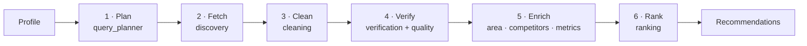

# Pipeline

From investor criteria to a ranked, explained shortlist. Orchestrated by
`backend/app/pipeline/orchestrator.py` (CHECKLIST I-09); each stage is one module.



Each stage emits a `StageEvent` (status, message, counts) that the UI polls, so the demo shows
the pipeline working live (F-20). A failing stage marks the run failed without discarding
earlier results.

> Status: stages are scaffolded. Details marked *(S-01)* are confirmed by the data coverage
> spike and must be updated here when it lands.

## 1 · Plan (`query_planner.py`, F-02)

**In:** `InvestorProfile` · **Out:** `list[PlannedQuery]`

Deterministic templates, not an LLM, so the same profile always costs the same searches and hits
the same cache keys. One site-filtered Google query per locality and portal group, plus Maps
queries for commercial listings. Capped by `SERPAPI_RUN_BUDGET`.

Draft template *(S-01)*:
```
{bhk} BHK {type} for sale {locality} Bangalore
  site:99acres.com OR site:magicbricks.com OR site:housing.com OR site:nobroker.in
```

## 2 · Fetch (`discovery.py`, F-02)

**In:** planned queries · **Out:** `list[RawSearchHit]`

Runs each query through the SerpApi gateway. Keeps `title`, `link`, `snippet`, `rich_snippet`,
`gps_coordinates` and `search_metadata.id` for provenance. Stops issuing live searches once the
run budget is spent and says so in the stage event.

## 3 · Clean (`cleaning.py`, F-02)

**In:** raw hits · **Out:** `list[Listing]`

1. Detect portal and canonicalise the URL.
2. Regex-parse price (`85 L`, `1.25 Cr`, `₹45,000/month`), area (sq ft, sq m, sq yd), BHK.
3. Classify the result: single **listing**, builder **project**, **aggregate** page, other.
   Aggregate pages are not properties, but their price ranges feed locality price stats.
4. De-duplicate: canonical URL first, then fuzzy title + price + locality (`rapidfuzz`).
   Merged listings keep every source.

## 4 · Verify (`verification.py`, `quality.py`, F-03, F-12)

**In:** listings + profile · **Out:** `Verification` per listing

- `extract` (Gemini lite, prompt `extract_listing`): fills only the fields regex missed; each
  value carries confidence and the exact text span it came from.
- `verify` (Gemini, prompt `verify_listing`): 0–100 match score, verdict, matched criteria,
  mismatches, missing data.
- `flag_listing` (rules): stale, duplicate, too-good-to-be-true, not a listing, missing data.

Rejected listings stay in the run with rank `null` so the UI can show what was filtered and why.

## 5 · Enrich (`enrichment/`, `metrics.py`, F-05, F-06, F-09)

**Area intelligence**: once per locality, cached `AREA_INTEL_TTL_HOURS`:

| Signal | Engine | Query shape *(S-01)* |
|---|---|---|
| Locality centre | google_maps | `"{locality}, Bengaluru"` |
| Amenities | google_maps | `"metro station"`, `"school"`, `"hospital"` near the centre |
| News and infrastructure | google_news | `"{locality} Bengaluru"` → classified by `classify_news` |
| Price level | google | `"{locality} Bangalore property rates per sq ft"` |
| Rental demand (P1) | google_trends | `"flats for rent {locality}"` for up to 5 localities in one call |

**Competitors** (commercial only): google_maps `"{business_type}"` near the property →
density, ratings, review volume, saturation. P1: google_maps_reviews for the top competitors →
`competitor_gaps` prompt.

**Metrics**: pure functions, no I/O:

| Metric | Formula |
|---|---|
| Price per sq ft | price / size |
| vs area average | (price per sq ft / locality average − 1) × 100 |
| Rental yield | monthly rent × 12 / price × 100, before any costs |
| Price growth | investor's override if set, else the locality's past-12-month change in price per sq ft |
| Total return | rental yield + price growth |
| Meets target | the goal's measure ≥ `target_roi_pct` (rental income → yield, appreciation → growth, balanced → total) |

No net yield or cap rate: both need cost assumptions we would have to source
([ADR 0010](decisions/0010-roi-definition.md)). Missing inputs give a missing metric, never zero.

## 6 · Rank (`ranking.py`, F-04)

**In:** verified, enriched listings · **Out:** `list[Recommendation]`

Composite score computed in code, with weights set by `goal` and `risk_appetite`:
match score, ROI vs target, price vs area average, area signals, and quality-flag penalties.
`score_breakdown` exposes each component. Gemini (`explain_recommendation`) writes only the
reason, highlights and risks, quoting numbers from the inputs.

## LLM calls per run

| Prompt | Model tier | Calls |
|---|---|---|
| `extract_listing` | lite | ≤ 1 per listing, only when regex left gaps |
| `verify_listing` | reasoning | 1 per listing |
| `classify_news` | lite | 1 per new locality |
| `summarize_area` | reasoning | 1 per new locality |
| `extract_rent` | lite | 1 per new locality and unit type |
| `competitor_gaps` | reasoning | 1 per commercial property (P1) |
| `explain_recommendation` | reasoning | 1 per top-N listing |
